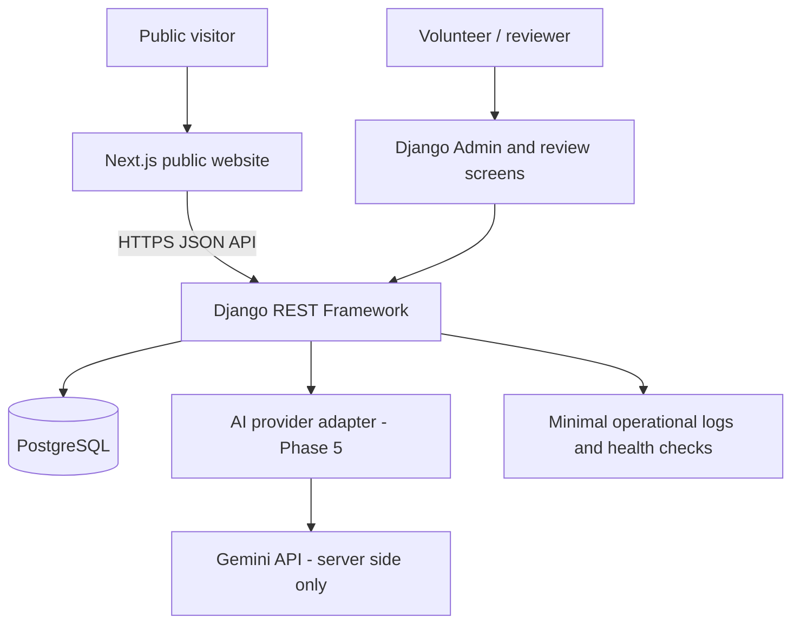

# FURSA (فرصة) — Engineering Source of Truth

**Status:** Authoritative engineering baseline for the MVP  
**Version:** 1.0  
**Date:** 17 October 2026  
**Product:** Bilingual Gulf job-discovery platform  
**Tagline:** Your Next Opportunity Starts Here  
**Initial coverage:** United Arab Emirates, Kuwait, Bahrain, Qatar, Saudi Arabia  
**Languages:** Arabic and English

> **This is the single engineering source of truth for FURSA.** Product requirements, UI/UX, architecture, stack, data model, acceptance criteria and phases live here. Old planning documents are reference material only. When an implementation choice conflicts with this file, follow this file and update it through a small, recorded decision before changing implementation.

## 1. Product in One Minute

FURSA (فرصة, “opportunity”) is a simple, bilingual job-discovery website for the Gulf. It brings public job opportunities into one searchable catalogue, makes important details easier to compare, keeps the original source visible, shows when a listing was last checked, and helps visitors spot suspicious or stale listings.

Job seekers can browse without creating an account. They do not upload CVs, build profiles, save jobs to a FURSA account, apply inside FURSA or share their physical location. Each job sends them to one of three external application routes: an employer/authorised recruitment website, email, or WhatsApp.

Volunteers collect and review job information. AI may help extract fields, translate, categorise, spot likely duplicates and flag risks, but a person controls publication. Admins are volunteers with additional permissions—not a separate business department.

**The MVP is a useful job catalogue first.** Build reliable job records, search, job pages and a small volunteer review workflow before spending time on sophisticated AI, analytics, alerts, monetisation, microservices or a complex administrative system.

## 2. Problem Statement

Job information across the Gulf is scattered across employer career pages, recruitment sites, professional networks and other public channels. Job seekers have to compare inconsistent titles, incomplete details, duplicated posts, unclear eligibility, expired opportunities and application links of uncertain quality. Arabic and English information may be split across different channels, and suspicious listings can waste applicants’ time or expose them to fraud.

Volunteer teams also need a practical way to collect source-backed vacancies, keep important details accurate, handle duplicates and reports, and remove expired or unsafe listings without publishing information directly from unreviewed submissions.

**FURSA’s problem statement:** Gulf job seekers need one place to discover relevant, fresh, source-backed vacancies across fragmented channels, without registering, disclosing personal details to FURSA or sharing their location with the platform.

## 3. Product Goals and MVP Boundaries

### 3.1 Goals

1. Offer one responsive public catalogue for jobs across the five initial Gulf countries.
2. Support Arabic and English as first-class languages, including proper right-to-left (RTL) layout.
3. Let visitors search by job title, keywords, skills, employer, country, administrative area and category.
4. Show the job description, known conditions, source link, last-checked date, status and external application option.
5. Preserve the source and evidence used for each vacancy; do not invent missing facts.
6. Let pseudonymous volunteers submit drafts and let an authorised volunteer reviewer approve or reject them.
7. Use AI only as an assistant. AI must never publish a vacancy or mark an employer as trustworthy on its own.
8. Make it easy to report a suspicious, expired, incorrect or broken listing.
9. Keep the codebase and hosting simple enough for a small volunteer team to run.

### 3.2 Explicitly out of scope for this MVP

- Monetisation, sponsored listings, ads, subscriptions, payments and commercial accounts.
- Candidate accounts, candidate profiles, CV uploads, in-platform applications, candidate messaging and hiring-outcome tracking.
- Personalised alerts, saved jobs tied to an identity, behavioural analytics, persistent visitor identifiers or ad tracking.
- GPS/browser geolocation, IP-based geolocation, inferred visitor country/city or location history.
- Employer self-service accounts or an employer-facing job submission portal.
- Chatbot-first product design.
- Microservices, Kubernetes, a separate search engine, a vector database, Redis/Celery or a complex workflow engine before there is a measured need.
- A complex legal-compliance subsystem, monetisation readiness process or country-by-country legal workflow in the engineering MVP.

Legal and commercial work are **not implementation phases for this MVP**. This does not mean a country is legally cleared for public launch; the engineering team should not build complex legal machinery or make claims of legal clearance. Keep the initial environment as development/staging until the product owner decides the public pilot is ready.

### 3.3 Geographic data

Include UAE, Kuwait, Bahrain, Qatar and Saudi Arabia in the data model from the beginning. Country and region information describes the vacancy, not the visitor. Store country subdivisions as maintained reference data rather than hard-coding location names throughout the UI. A public launch country can be switched on or off through one simple configuration flag; do not build a large legal-gate subsystem.

## 4. Product Principles

- **Evidence over claims:** every active vacancy must retain a source record.
- **No invented facts:** use “Not specified by employer” when the source does not support a field.
- **External application only:** FURSA is not the recipient of an application.
- **No candidate account or location tracking:** public discovery stays anonymous by design.
- **Human-owned publishing:** people approve; AI suggests.
- **Arabic is not an afterthought:** core screens and workflows must work in Arabic RTL.
- **Honest trust language:** say what was checked and when; do not promise that a job is guaranteed or perfectly verified.
- **Few moving parts:** start with one repository, one API, one database and one deploy provider.
- **Ship in vertical slices:** build a complete search-to-job-detail journey early, then add review and intelligence.

## 5. Final Technology Stack Decision

This is the final MVP stack unless a measured test shows a blocker. Do not reopen the framework choice during the build just because another tool is popular.

| Area | Final decision | How we use it in FURSA |
|---|---|---|
| Repository | One GitHub repository / monorepo | `apps/web`, `apps/api`, `docs`; one change history and shared source of truth |
| Public website | Next.js App Router + React + TypeScript | Responsive, crawlable public pages, English/Arabic routes, job listings and details |
| Styling | Tailwind CSS + FURSA design tokens | Shared spacing, colours, typography, responsive layouts and status styles |
| Backend/API | Python + Django + Django REST Framework (DRF) | Source records, vacancies, review workflow, permissions, reports, audit events and API validation |
| First internal admin | Django Admin, configured for the FURSA models | Fast, functional volunteer operations; build a custom review queue only where Django Admin is insufficient |
| Database | PostgreSQL | The authoritative store for vacancies, sources, review decisions, regions and audit events |
| Search | PostgreSQL full-text search + ordinary filters and indexes | No separate search engine for the MVP |
| AI | One provider adapter in Python; first live provider is Google Gemini API, paid API access only | Enable after the base workflow works; call it only for bounded extraction/classification/translation tasks |
| AI fallback | None in the MVP | If the provider fails, keep the draft and ask a person to complete it; do not add automatic multi-provider routing |
| Async jobs | Django management commands and a simple scheduled job initially | Add Celery + Redis only if measured task volume/reliability makes it necessary |
| File/source storage | Store source URLs and structured text in PostgreSQL; add private object storage only when source documents genuinely require it | Do not build an elaborate document-ingestion store in Phase 1 |
| Hosting | Render for the web app, API and managed PostgreSQL | One provider, same region/private networking where available |
| Initial hosting region | Frankfurt for the development/pilot baseline | Run a basic latency test before public pilot; do not put the app and database in different regions |
| CI | GitHub Actions | Lint, tests, type checks, build checks and dependency checks on pull requests |
| Backend tests | pytest + Django/DRF test tools | Unit, API, permission and workflow tests |
| Browser tests | Playwright | Public search/job journey and key Arabic RTL checks |
| API schema | DRF-generated OpenAPI schema | Keep frontend/backend contracts explicit and testable |
| Error/health monitoring | Provider health checks and privacy-minimised application error reporting | No individual visitor journey tracking |

### 5.1 Hosting note

Render currently supports web services for both Django and Next.js, managed PostgreSQL, and regions including Frankfurt and Singapore; its static sites use a global CDN. FURSA will initially use Render because it can host the two applications and database with relatively few operational parts. Frankfurt is the baseline, not a claim that it is the lowest-latency region for all Gulf users; measure latency before public pilot and keep the API/database in the same region. See the official [Render web-services guide](https://render.com/docs/web-services), [Django deployment guide](https://render.com/docs/deploy-django), [Next.js deployment guide](https://render.com/docs/deploy-nextjs-app) and [regions guide](https://render.com/docs/regions).

### 5.2 Stack rules

- Use the currently supported stable release when scaffolding, then pin dependencies in committed lockfiles/requirements files. Do not float production dependencies without review.
- Never put database credentials, Django secret keys or AI provider keys in frontend code or Git.
- No live AI provider integration until Phase 5. First build the interface and deterministic workflow; in tests, use a fake provider.
- Keep all AI calls on the Django server and send only the minimum public job content needed for the task.
- No Redis, Celery, pgvector, a third-party analytics suite or a separate search product in the initial deployment.
- Do not split Django into multiple services. Use clear Django apps/modules inside one backend.

## 6. High-Level Architecture

### 6.1 Architecture rules

1. PostgreSQL is the source of truth for listing content and publication state.
2. The frontend displays permissions and states, but Django enforces them.
3. The public API returns only approved public fields; internal evidence and volunteer identity are never exposed.
4. Drafts, rejected listings and suspended listings are not returned by public search/detail endpoints.
5. Publication status can change only through backend workflow methods, not by directly editing a public-facing field from the browser.
6. Store source text, extracted/suggested fields and reviewed/published fields separately where needed. Preserve the original source link and original text used to support material facts.
7. Keep the code modular: `accounts`, `sources`, `vacancies`, `locations`, `review`, `reports`, `search`, `ai` and `audit`. These are Django apps/modules, not separate services.
8. Every material status transition writes an audit event in the same database transaction.
9. Fail closed: if a source, application route or required review is missing, do not publish.
10. Add infrastructure only after a concrete performance or reliability issue has been measured.

## 7. Users and Permissions

Admins are volunteers too. There is no separate employee or commercial operations hierarchy in the MVP. Use one volunteer account system with three simple permission levels:

| Role | Can do | Cannot do |
|---|---|---|
| Contributor | Create and edit own drafts; attach a source; submit drafts for review | Publish; alter audit history; view private account/security secrets |
| Reviewer | Review sources and fields; handle duplicates/reports; approve or reject listings | Approve a listing they submitted themselves; edit/delete historical audit events |
| Admin | Invite/disable volunteer accounts, manage configuration, and perform reviewer actions | Bypass mandatory field/source checks or erase audit events |

A single volunteer may hold more than one permission level. The submitter must not approve their own listing. No public registration exists for volunteer accounts. Accounts are invitation-only, use unique credentials and pseudonyms, and must be disabled promptly when a volunteer leaves. Require MFA for admin/reviewer accounts when deploying the volunteer portal beyond local development.

## 8. Core User Journeys

### 8.1 Public visitor

1. Open the home page in Arabic or English.
2. Search by job title, skill, keyword or employer.
3. Refine by country, administrative area, category, work type and recency where data is available.
4. Open a job detail page.
5. Review job facts, what was not specified, source, last checked date and any caution message.
6. Use the reviewed employer website, email or WhatsApp route to apply externally.
7. Report an expired, incorrect, suspicious or broken listing if necessary.

### 8.2 Contributor volunteer

1. Sign in to the private volunteer area.
2. Paste a source URL and record basic source details.
3. Create a draft and enter known job fields; optional AI suggestions arrive later in Phase 5.
4. Submit the draft for review.
5. See whether the draft was approved, rejected or needs edits.

### 8.3 Reviewer volunteer

1. Open the review queue.
2. Check source provenance, job details, date/freshness and application route.
3. Check for duplicates and obvious scam indicators.
4. Ensure unsupported facts are omitted or marked “Not specified by employer”.
5. Approve, reject or return for edits with a reason.
6. Suspend or expire a published job if a report or source check warrants it.

## 9. UI/UX and Design System

### 9.1 Brand and visual language

- Brand: **FURSA / فرصة**.
- Tagline: **Your Next Opportunity Starts Here.**
- Supporting line: **Fresh Jobs. Clear Facts. Smarter Matches.**
- Personality: professional, clear, modern, accessible, calm and trustworthy. Do not use government-looking seals or imagery that implies guaranteed employment.

| Token | Value | Use |
|---|---|---|
| `brand.navy` | `#10243A` | Brand, headings, primary navigation |
| `brand.teal` | `#16A69A` | Main action, links, selected controls |
| `surface.white` | `#FFFFFF` | Cards and reading surfaces |
| `surface.mist` | `#F3F6FA` | Page background and filter areas |
| `status.amber` | `#F2B544` | New/needs-attention labels |
| `status.danger` | `#B42318` | Warning and critical report states |
| `text.primary` | `#10243A` | Main text |

Status must always include text, not colour alone. Use visible focus outlines, readable type, sufficient contrast and restrained motion. Avoid visual clutter and oversized banners.

### 9.2 Responsive behaviour

- Mobile-first layout, designed for small-screen job search.
- Search and core filters remain easy to reach on mobile; detailed filters may collapse into a clear drawer/panel.
- Job cards use a predictable hierarchy: title, employer/source, country/region, workplace type if known, last-checked or published date, and a clear action.
- Do not force a user to hover to see important information.
- Use semantic HTML, keyboard navigation and accessible labels.

### 9.3 Bilingual and RTL requirements

- Locale routes: `/en/...` and `/ar/...`.
- User changes language manually; do not infer language from physical location.
- For Arabic, set page direction to RTL and review navigation, breadcrumbs, filter order, cards, pagination, keyboard focus and forms.
- Handle mixed-direction content such as Latin titles, URLs, salaries, phone numbers and email addresses without visual reordering errors.
- Preserve original source language. Mark machine-translated text as a translation; do not overwrite the source.
- Use a consistent date and currency presentation and clearly label unknown data.
- English and Arabic must have functional parity for all core journeys, not just translated homepage text.

### 9.4 Public pages and components

| Page | Required content and actions |
|---|---|
| Home | FURSA identity, search field, country/category browse, recent jobs, concise trust/safety note, language switch, report/about links |
| Search results | Keyword field, filters, result count, sorting by relevance/newest/last checked when available, empty state, loading state and retry/error state |
| Job detail | Title, employer as supported by evidence, location, employment/work mode, salary only when supplied, description, qualifications, eligibility/sponsorship labels, source link, dates, last checked, caution notes and external apply button |
| About | Explain that FURSA is a job-discovery information service and does not employ candidates or accept applications |
| Report a job | Select issue, optional explanation and submit; explain not to include CVs, ID documents or sensitive personal information |
| Privacy and safety | Explain anonymous browsing, external application handoff, source/freshness limits and safe-use advice in plain language |
| Volunteer sign-in | Private route, no public sign-up, accessible authentication and recovery instructions |

### 9.5 Job card information order

1. Job title.
2. Employer or source name, only as supported by the source.
3. Country and region.
4. Employment type/work mode, if stated.
5. Salary range, only if present in the source.
6. Posted date and FURSA “last checked” date as separate labels.
7. Clear status/caution text.
8. View details action.

### 9.6 Accessibility and performance targets

- Target WCAG 2.2 AA for public and volunteer workflows; test the core journeys rather than assuming compliance.
- Structured search response: p95 under 1.5 seconds for the MVP benchmark dataset.
- Semantic search response (only when added): p95 under 3 seconds.
- Test on a low-end mobile device and a realistic slower network.
- Use paginated results, indexes, optimised images and caching that cannot accidentally expose a draft or suspended listing.

## 10. Functional Requirements (SRS)

### FR-01 — Public discovery without registration

- All core public pages and search work without an account.
- No candidate account, profile, CV upload, saved-job account or in-platform application routes.
- Search filters are transient. Do not store identifiable search history.

**Acceptance:** A new visitor can search and open a job without signing in; no candidate-registration or CV-upload route exists.

### FR-02 — Search and filtering

- Search title, employer, skills and searchable description text.
- Filter by country, administrative region, category, work type and date/recency where those fields exist.
- Search only active, published listings by default.
- Support English and Arabic text and cross-language matching improvements in Phase 5.
- Empty, zero-result, loading and error states are required.

**Acceptance:** Tests cover filters in combination, pagination, stale listing exclusion, Arabic query entry and empty/error states.

### FR-03 — Vacancy details

- Store the source URL and source name.
- Preserve source-derived job facts and record the last checked time.
- Keep “original publication date”, “FURSA publication date” and “last checked” separate.
- Show only facts supported by the source; missing facts appear as “Not specified by employer”.
- Every public job detail must have at least one reviewed external application route.

**Acceptance:** Public detail contains only approved public fields and offers no in-platform application mechanism.

### FR-04 — External application

Exactly three route types are supported:
1. Employer or authorised recruitment website.
2. Email (`mailto:` link).
3. WhatsApp.

Record the destination, the evidence supporting it and the date last checked. Warn or suspend the job when the route is known to be broken or becomes suspicious. Do not proxy the user's email or WhatsApp conversation through FURSA.

**Acceptance:** Unknown or unreviewed routes cannot satisfy the publication requirement; the route opens externally and the handoff is clear.

### FR-05 — Source and vacancy intake

- A contributor can add a permitted source URL, create a draft and submit it for review.
- Retain provenance: source URL, source name/class, source checked date, original text/evidence sufficient to support facts and contributor-internal audit reference.
- Support manual entry first. Bulk scraping and complex automated ingestion are not MVP requirements.
- Do not republish content from a source that the team has not determined is permitted for use. For the MVP, prefer public employer careers pages and clearly authorised sources.

**Acceptance:** A reviewer can determine where each material field came from and can return an incomplete draft without publishing it.

### FR-06 — Review and publication

Keep the workflow intentionally small:

`DRAFT → PENDING_REVIEW → PUBLISHED`

Alternative outcomes:

`PENDING_REVIEW → NEEDS_CHANGES / REJECTED`

For published records:

`PUBLISHED → SUSPENDED / EXPIRED / CLOSED`

- Contributor cannot publish.
- Submitter cannot approve their own listing.
- Publish requires a source, minimum job details, at least one reviewed external application route and reviewer approval.
- Unresolved critical scam indicators or missing required evidence block publication.
- Record who acted, when, what changed and the reason.

**Acceptance:** Backend tests prove that direct API requests cannot bypass publication checks, and drafts/suspended/rejected records never appear in public results.

### FR-07 — Basic freshness and expiry

- Keep original posted date separate from FURSA dates.
- If the source gives an application deadline, flag/expire the listing when it passes unless a reviewer confirms an extension.
- Start with a configurable default maximum active period of 30 days when no deadline exists; reviewers can revalidate with a reason.
- Rechecking does not reset the original posted date.
- Broken application links should trigger re-check and possible suspension.

**Acceptance:** Scheduled freshness processing is repeatable; an expired listing is absent from active search.

### FR-08 — Job report and safety

- Visitors can report a listing as suspicious, expired, incorrect or broken.
- The report form does not ask for a candidate's personal identity, CV, passport or sensitive details.
- Report rate limiting/challenge protects the endpoint from spam without creating a persistent visitor profile.
- Reviewer can inspect reports, suspend a listing and record a resolution.

**Acceptance:** A report creates a private review item; report contents are never exposed through public job APIs.

### FR-09 — Volunteer accounts and permissions

- Invitation-only accounts; no public volunteer registration.
- Unique account credentials and pseudonym per volunteer.
- Contributor, Reviewer and Admin permissions as defined in Section 7.
- Apply server-side role and object-level permissions to every privileged API action.
- MFA for privileged deployed accounts.

**Acceptance:** Automated tests cover allowed and denied actions for each role, including the submitter/self-approval restriction.

### FR-10 — AI assistance (Phase 5 only)

- Extract structured fields from supplied public vacancy text.
- Suggest category/job-title normalisation and translation.
- Suggest probable duplicates and risk indicators.
- All output is advisory and visibly labelled as a suggestion.
- Preserve original text; validate output against a schema; never let AI publish, approve a source, certify an employer or override a reviewer.
- On provider timeout, invalid output or outage, keep the draft usable for manual review.

**Acceptance:** Tests prove an AI response cannot change publication status; malformed/failed responses do not corrupt the draft.

### FR-11 — No visitor geolocation or identity tracking

- Never request device GPS/browser geolocation.
- Never use IP-derived location to choose country, region, language or results.
- No persistent visitor profile, behavioural tracking, fingerprinting or cross-site advertising identifier.
- Keep operational/security logs minimal and avoid raw visitor IP in application logs. Network providers may process connection metadata; do not make false claims that infrastructure can never see it.

**Acceptance:** Code review confirms no geolocation or analytics SDK; no location permission prompt; no user identifier stored across anonymous browsing sessions.

### FR-12 — Operations and audit

- Record material changes to sources, vacancy facts, routes, review state, reports and volunteer permissions.
- Logs include actor/service, timestamp, object, action and reason, while avoiding unnecessary personal data.
- Provide health checks, error reporting, backups and a documented restore test before pilot.

**Acceptance:** A reviewer can reconstruct why a job was published or removed; a backup can be restored in staging.

## 11. Core Data Model

Use UUID primary keys unless there is a clear reason not to. Put business invariants in Django validation/services and database constraints where possible.

### 11.1 `Vacancy`

- `id`
- `title_original`, `title_en`, `title_ar` (translations/suggestions nullable until reviewed)
- `employer_name` (nullable if unsupported)
- `description_original`, `description_en`, `description_ar`
- `country_code`, `region_id`, optional `locality`
- `category_id`, optional skills/taxonomy links
- `employment_type`, `work_mode`
- `salary_min`, `salary_max`, `salary_currency`, `salary_period` (nullable; never infer)
- `eligibility_text`, `sponsorship_status` (`OFFERED`, `NOT_OFFERED`, `NOT_SPECIFIED`)
- `original_posted_at`, `received_at`, `published_at`, `last_checked_at`, `deadline_at`, `expires_at`
- `status` (`DRAFT`, `PENDING_REVIEW`, `NEEDS_CHANGES`, `PUBLISHED`, `SUSPENDED`, `EXPIRED`, `CLOSED`, `REJECTED`)
- `submitted_by_id`, `reviewed_by_id`, `reviewed_at`, `review_reason`
- `created_at`, `updated_at`

### 11.2 `Source`

- `id`, `name`, `source_url`, `source_type`
- `permission_note` or source-usage decision for internal review
- `source_last_checked_at`, `created_at`, `updated_at`
- restricted source evidence/extracted text sufficient to support published facts

### 11.3 `ApplicationRoute`

- `id`, `vacancy_id`, `route_type` (`WEBSITE`, `EMAIL`, `WHATSAPP`)
- `destination`, `supporting_source_id`, `last_checked_at`
- `status` (`NEEDS_REVIEW`, `OK`, `BROKEN`, `SUSPICIOUS`)

### 11.4 `Region` and `Category`

Use reference tables for countries, first-level administrative subdivisions and job categories. Do not duplicate region names in UI code. Store display names for both languages where practical.

### 11.5 `JobReport`

- `id`, `vacancy_id`, `report_type`, `message` (optional and length-limited)
- `status` (`OPEN`, `IN_REVIEW`, `RESOLVED`, `DISMISSED`)
- timestamps, assigned reviewer, resolution note
- Avoid requiring the reporter's email, phone number or name.

### 11.6 `ReviewEvent` / `AuditEvent`

- `id`, `actor_user_id` or service identifier, `object_type`, `object_id`, `action`
- timestamp, reason and safe summary of material changes
- Append-only through application permissions; do not expose publicly

### 11.7 `VolunteerAccount`

Use Django’s authentication system. Store a pseudonymous display handle and role/permission assignments. Never put a volunteer’s private identity/contact details on vacancy records returned to the public.

## 12. API Contract (MVP)

Use JSON over HTTPS with a version prefix `/api/v1/`. Generate and validate an OpenAPI schema.

### Public endpoints

| Method | Path | Purpose |
|---|---|---|
| `GET` | `/api/v1/jobs/` | Search/filter published active vacancies |
| `GET` | `/api/v1/jobs/{id}/` | Published public details only |
| `GET` | `/api/v1/countries/` | Enabled countries and display names |
| `GET` | `/api/v1/regions/?country=...` | Regions for selected country |
| `GET` | `/api/v1/categories/` | Job category options |
| `POST` | `/api/v1/jobs/{id}/reports/` | Submit a constrained safety/accuracy report |
| `GET` | `/api/health/` | Health check without sensitive configuration details |

### Volunteer endpoints

| Method | Path | Purpose |
|---|---|---|
| `GET/POST` | `/api/v1/volunteer/drafts/` | List permitted drafts / create a draft |
| `GET/PATCH` | `/api/v1/volunteer/drafts/{id}/` | Read or edit a permitted draft |
| `POST` | `/api/v1/volunteer/drafts/{id}/submit/` | Submit for review |
| `GET` | `/api/v1/volunteer/review-queue/` | Review queue for authorised reviewers |
| `POST` | `/api/v1/volunteer/jobs/{id}/approve/` | Approve after server-side checks |
| `POST` | `/api/v1/volunteer/jobs/{id}/request-changes/` | Return to contributor with reason |
| `POST` | `/api/v1/volunteer/jobs/{id}/reject/` | Reject with reason |
| `POST` | `/api/v1/volunteer/jobs/{id}/suspend/` | Suspend a published listing |
| `GET` | `/api/v1/volunteer/reports/` | Private report queue |

Public API responses must whitelist fields explicitly. Never return drafts, private evidence, internal notes, volunteer emails or private account information. Use stable error codes and do not return stack traces or provider internals.

## 13. Trust, Source Quality and Listing Rules

An active vacancy must have at least one identifiable source and one reviewed external application route. The reviewer checks whether the source supports the important facts and whether the external route appears consistent with the stated employer/recruiter. Do not display a generic “Verified Job” badge by default. Prefer factual labels such as “Source link available”, “Application link checked on [date]” or “Some details not specified”.

Flag for manual review when there are signals such as:

- A request for payment to apply, obtain an interview or secure a job.
- A source URL/domain or application route that does not match the stated organisation without a credible explanation.
- Unsupported claims about salary, benefits, sponsorship, visas or guaranteed hiring.
- A broken, redirected, suspicious or inconsistent application destination.
- Duplicate records or conflicting dates.
- Missing source evidence for an important claim.

These signals are reasons for review, not proof by themselves. Do not label an employer fraudulent unless an authorised process has established sufficient evidence. If a report is credible or a route appears dangerous, suspend the listing while it is investigated.

## 14. AI Rules

AI does not need to be wired in before core job workflows are working. Phase 5 adds the first provider call behind an internal interface such as `FursaAIProvider`, with a fake provider used in automated tests.

Allowed initial tasks:

1. Extract candidate fields from a public job description into a strict schema.
2. Suggest category, skill and title normalisation.
3. Translate descriptions between Arabic and English while preserving source text.
4. Suggest likely duplicates.
5. Highlight risk indicators for human review.

Not allowed:

- Publishing or approving a vacancy.
- Inventing a missing salary, eligibility, sponsorship status, employer identity, date or application contact.
- Deciding a candidate’s nationality, legal right to work or likely personal characteristics.
- Sending volunteer identities, passwords, security tokens or private admin notes to the AI provider.
- Treating AI-generated text as source evidence.

Validate provider responses with a schema, set timeouts and a hard usage budget, log provider/model/version metadata without storing unnecessary prompts, and keep a human-editable path on failure. Use the paid API, not a free tier, for the first production integration. Before enabling it, run a small, manually reviewed Arabic/English test set for extraction correctness, translation fidelity, false risk flags and duplicate suggestions.

## 15. Security and Privacy Baseline

Keep this practical, not bureaucratic. Implement basic protections from the beginning:

- HTTPS in deployed environments, secure session/cookie settings, CSRF protection where applicable and restricted CORS.
- Server-side validation and role/object-level authorisation for every privileged action.
- MFA for reviewer/admin accounts; unique credentials; no shared volunteer accounts.
- Secrets in environment/hosting secret stores, never in source control or frontend bundles.
- Private PostgreSQL access, least-privilege database account and tested backups.
- Keep Django debug mode off in deployment, restrict allowed hosts and configure trusted origins.
- Protect report endpoints against abuse with rate limits/challenges; avoid collecting reporter identity unless there is a separately approved need.
- Prevent open redirects and validate external URLs before linking. The public browser must open external links clearly; use safe link attributes when opening a new tab.
- Apply safe file upload restrictions if upload support is introduced later. Do not introduce uploads in the MVP without a clear need.
- Use a reasonable security baseline aligned with OWASP ASVS Level 2 for the public app and volunteer/admin functions. Do not claim certification without an assessment.
- Use security headers including an appropriate Content Security Policy, HSTS in HTTPS production, `X-Content-Type-Options`, an appropriate frame policy and a strict referrer policy (`no-referrer` where feasible).
- Avoid raw visitor IP in application logs; document and minimise operational metadata processed by hosting/network providers.
- Keep logs access-controlled and retention limited. Do not put secret tokens, full credentials or unnecessary personal information into logs.
- Add CI dependency and secret checks before any public pilot.

## 16. Non-Functional Requirements

| Area | MVP requirement |
|---|---|
| Usability | A visitor can search, inspect a listing and reach an external application route without an account |
| Localisation | Full core journey in English and Arabic, with correct RTL behaviour |
| Accessibility | WCAG 2.2 AA target for core public/admin paths, manually and automatically tested |
| Performance | p95 structured search <1.5 seconds on the agreed benchmark; test low-end mobile and slower connection |
| Security | Role permissions, source/publication checks, secure sessions, secrets protection, audit history, dependency scanning |
| Reliability | Health check, error handling, backups and a successful restore rehearsal before public pilot |
| Privacy | No accounts/profiles for job seekers, no location tracking, no behavioural visitor tracking |
| Data quality | Source and last-checked information retained; missing facts shown as unspecified |
| Maintainability | Modular Django monolith, typed frontend, migrations, automated tests, documented local start instructions |
| Cost control | One hosting provider, one AI provider initially, no unnecessary paid infrastructure |

## 17. Phased Delivery Plan

Phases are ordered by dependency. Work on a phase is complete when its exit criteria pass—not merely when code has been written.

### Phase 0 — Repo and project setup

**Goal:** Make the repo safe and ready for real implementation.

Work:
- Confirm the GitHub repository and grant the connected GitHub integration access.
- Keep this file at `docs/ENGINEERING_SOURCE_OF_TRUTH.md` and link it from `README.md`.
- Create monorepo directories: `apps/web`, `apps/api`, `docs`.
- Add `.gitignore`, `.env.example`, a concise README and a pull-request template.
- Enable GitHub Actions for lint/test/build checks; protect the default branch where available.
- Define basic issue labels: `phase`, `bug`, `feature`, `docs`, `security`.

Deliverables:
- Clean repository layout and local-development instructions.
- Source-of-truth doc committed and linked.
- No secrets or credentials committed.

Exit criteria:
- A new contributor can clone the repo, understand the phases and follow the setup instructions.

### Phase 1 — Working application skeleton

**Goal:** Get the frontend, API and database running before implementing product features.

Work:
- Scaffold Next.js + TypeScript + Tailwind under `apps/web`.
- Scaffold Django + DRF under `apps/api`.
- Configure PostgreSQL locally and database migrations.
- Add `GET /api/health/` and a frontend health/status page for development.
- Add API schema generation, linting, formatting and starter tests.
- Add development environment examples without real secrets.
- Create a Render deployment blueprint/config after the local services start reliably.

Deliverables:
- Frontend and backend boot locally.
- Database connection and first migration.
- CI runs on push/pull request.

Exit criteria:
- Clean setup works on a fresh checkout; tests and builds pass; no real API keys are required.

### Phase 2 — Design system and public UI shell

**Goal:** Establish the design language and working bilingual navigation.

Work:
- Build header, footer, language switch, search component, filter controls, job card, status labels, loading/empty/error states and shared form styles.
- Add `/en` and `/ar` route structures and RTL document configuration.
- Implement the home page with sample data only.
- Build a simple responsive skeleton of search results and job details.
- Add Playwright coverage for language switching, mobile layout and keyboard basics.

Deliverables:
- Approved UI foundation and page shells.
- English and Arabic can navigate through the same core journey.

Exit criteria:
- Core public components are reusable; Arabic is usable in RTL, not merely translated; no backend dependency blocks UI progress.

### Phase 3 — Core job data, source records and search

**Goal:** Build the first real working product: create job records, search and view details.

Work:
- Implement `Vacancy`, `Source`, `ApplicationRoute`, `Region` and `Category` models and migrations.
- Seed five countries and their first-level divisions, plus a small starter category taxonomy.
- Implement the public API endpoints in Section 12.
- Add PostgreSQL full-text search, filters, indexes and pagination.
- Connect Next.js search and job-detail pages to the real API.
- Show source and last-checked details; clearly label missing fields.
- Add test data via fixtures/management command; do not scrape at scale.

Deliverables:
- End-to-end public search and job details backed by PostgreSQL.
- Basic bilingual dataset and API contract.

Exit criteria:
- Search and detail tests pass; public API only returns published active records; structured search meets the performance target on the agreed test dataset.

### Phase 4 — Volunteer workflow and safety reporting

**Goal:** Make job publishing safe and manageable by volunteers.

Work:
- Configure invitation-only Django accounts and Contributor/Reviewer/Admin permissions.
- Build draft creation/editing, submit-for-review, review queue, approve/request-changes/reject actions.
- Enforce “submitter cannot approve own listing” on the server.
- Add reviewed application routes, source evidence, internal review reasons and audit events.
- Add simple safety report form and private report queue.
- Add expiry/suspension behaviour and a scheduled management command.
- Configure MFA for deployed privileged accounts and validate access controls.

Deliverables:
- Basic volunteer/admin workflow with full server-side permissions.
- Report/suspend/fix loop.

Exit criteria:
- Permission tests prove unauthorised publication is impossible through the API; every active public listing has a source and reviewed external application route; audit events are created transactionally.

### Phase 5 — AI assistance (small and optional)

**Goal:** Save volunteers time without letting AI control the product.

Work:
- Implement `FursaAIProvider` interface and a fake provider for tests.
- Integrate the Gemini paid API using a server-side secret.
- Add structured vacancy extraction from supplied public source text.
- Add title/category suggestions and optional Arabic-English translation.
- Validate responses, keep AI output as editable suggestions, and add timeout/budget limits.
- Create a small manually reviewed Arabic/English benchmark; evaluate false positives and factual error rates.
- Do not implement AI semantic search, personalised alerts or sophisticated ranking yet.

Deliverables:
- Optional, measurable AI suggestions in the intake workflow.
- Manual processing still works if AI is disabled or unavailable.

Exit criteria:
- Tests prove AI cannot publish; failure leaves the draft intact; benchmark results are recorded in the repo.

### Phase 6 — Hardening and controlled pilot

**Goal:** Make the core service reliable enough for a small, supervised pilot.

Work:
- Run end-to-end tests for search, application handoff, volunteer review and reporting.
- Test Arabic RTL, keyboard navigation and colour contrast across core pages.
- Run dependency/secret checks and a focused security review of authentication, URL handling, APIs and publication gates.
- Benchmark search on mobile/slow network and fix the highest-impact problems.
- Configure error monitoring, health checks, backups and complete a database restore rehearsal.
- Check that logs do not record visitor geolocation, persistent visitor identifiers or raw IP in application logs.
- Create a small, manually verified set of source-backed real listings; review each listing and application route before enabling the pilot.
- Keep monetisation, candidate accounts, location tracking and unnecessary infrastructure disabled.

Deliverables:
- A stable pilot build, acceptance-test record, backup/restore evidence and a short known-issues list.

Exit criteria:
- No critical publication bypass or access-control issue remains; core journey works in both languages; backup restores; the source review process is operational; the product owner explicitly approves the pilot.

### Phase 7 — Improve from evidence

**Goal:** Add only the improvements that the pilot demonstrates are needed.

Candidate improvements:
- Better Arabic-English search ranking after evaluation.
- Duplicate suggestions and risk triage after manual labels exist.
- More source intake helpers if manual intake becomes a bottleneck.
- Celery/Redis if background workload grows beyond scheduled commands.
- pgvector only if test evidence shows PostgreSQL text search is insufficient.
- Custom reviewer screens only if Django Admin slows the team down.

Exit criteria for any enhancement:
- A documented user need, acceptance criteria, test coverage, cost/operations impact and a rollback path.

## 18. Definition of Done

A feature is done only when:

- It fulfils the relevant requirements in this document.
- Server-side validation and permissions are present where required.
- Errors, loading and empty states are handled.
- English and Arabic behaviour is considered, with RTL tested where relevant.
- Automated tests cover normal and failure paths.
- New fields are migrated and documented; public API fields are explicitly whitelisted.
- No secret or unnecessary personal data has been added to logs or frontend bundles.
- User-facing trust statements are factual, not absolute.
- The feature passes CI and is reviewed before merging.

## 19. MVP Release Checklist

- [ ] Public search, filters and job detail work on a mobile browser.
- [ ] Arabic and English core journeys work; Arabic layout is RTL.
- [ ] Every active listing has source provenance and a reviewed application route.
- [ ] Missing job facts are labelled as unspecified, not fabricated.
- [ ] Public endpoints exclude drafts, rejected and suspended listings.
- [ ] Contributor cannot publish; submitter cannot approve own listing.
- [ ] Report handling, suspension and expiry work.
- [ ] No candidate account, CV upload, in-platform application, geolocation or visitor profiling exists.
- [ ] AI is disabled by default until Phase 5 passes its tests and evaluation.
- [ ] Secrets are server-side; database is not publicly exposed; privileged access is protected.
- [ ] CI tests pass, dependencies are checked, and error monitoring is configured.
- [ ] Backup and database restoration have been tested.
- [ ] A small human-reviewed set of real listings is ready for the controlled pilot.

## 20. Working Agreements

- Build the smallest complete version first: search → job detail → external application.
- Then add draft intake → human review → publication → report/suspend.
- Only then add AI suggestions.
- Keep pull requests focused and tests close to the code.
- Do not introduce a new provider, library or service without a direct reason tied to an acceptance criterion.
- Keep decisions in this file when they affect requirements, architecture or the stack. Small implementation details can live near the code.
- If a feature is not in this document, it is not part of the MVP until added through a short, explicit decision.

## 21. Source Material and Current Technical References

This document consolidates the intent of the earlier FURSA materials:

- SRS v2.0 — product requirements, Gulf coverage, anonymous discovery, Arabic/English, source integrity and safety.
- Technology Architecture & AI Provider Policy — stack and AI integration direction.
- Implementation Master Blueprint v1.0 — architecture, data model, APIs, security and operations.
- Implementation Phases and Delivery Roadmap — sequencing and acceptance criteria.

Those documents are reference history, not competing sources of truth. This file deliberately simplifies the first release: monetisation and complex legal workflow are deferred; volunteer roles are consolidated; Django Admin is the starting admin interface; AI and additional infrastructure come later.

Official platform references:
- [Next.js App Router](https://nextjs.org/docs/app)
- [Next.js internationalisation](https://nextjs.org/docs/app/guides/internationalization)
- [Django documentation](https://docs.djangoproject.com/)
- [Django REST Framework](https://www.django-rest-framework.org/)
- [PostgreSQL documentation](https://www.postgresql.org/docs/)
- [PostgreSQL full-text search](https://www.postgresql.org/docs/current/textsearch.html)
- [Tailwind CSS documentation](https://tailwindcss.com/docs)
- [Render web services](https://render.com/docs/web-services)
- [Render regions](https://render.com/docs/regions)

---

**Immediate next step:** Make the created GitHub repository visible to the connected GitHub integration, then commit this file at `docs/ENGINEERING_SOURCE_OF_TRUTH.md` and start Phase 0/Phase 1. Do not create a second competing master document.
